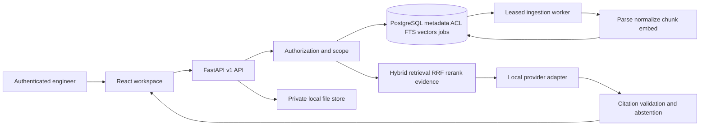
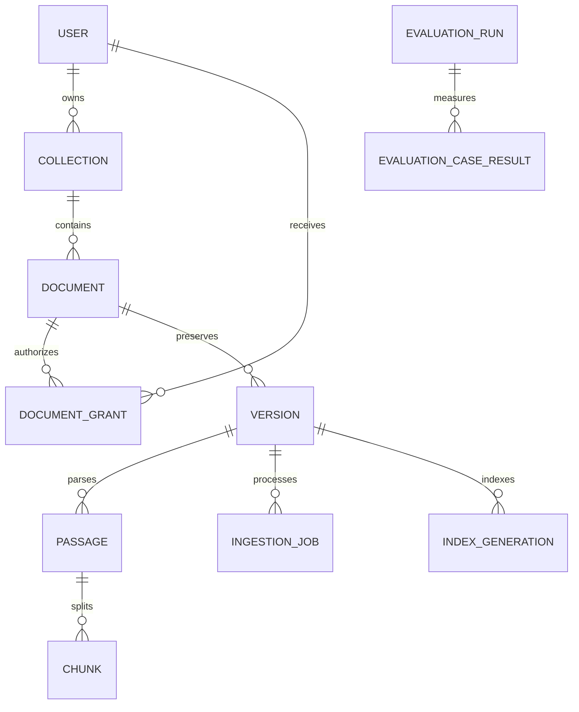
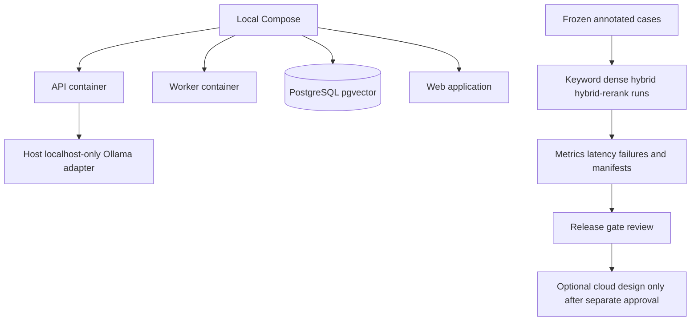

# KnowDoc AI architecture proposal

Approved local architecture proposal. The current implementation and verification limits are documented in docs/architecture/system-design.md and PROJECT_STATUS.md. Modular monorepo: `apps/api`, `apps/web`, `src/knowdoc`, `workers`, `migrations`, `tests`, `evals`, `docs`, and `infrastructure` only as functionality lands.

## Context and components



## Ingestion and recovery

```mermaid
sequenceDiagram
 participant U as User
 participant A as API
 participant D as Database
 participant W as Worker
 U->>A: Authorized upload with version metadata
 A->>A: Verify magic bytes, limits, safe generated path, SHA-256
 A->>D: Commit version and queued job
 A-->>U: 202 job ID
 W->>D: Claim lease
 W->>W: Parse, preserve sections/pages, chunk, embed
 W->>D: Stage complete index generation
 W->>D: Atomically activate generation and mark ready
 Note over D,W: Expired lease retries with bounded attempts; failures retain prior active index
```

## Retrieval and permissions

```mermaid
sequenceDiagram
 participant U as User
 participant A as API
 participant D as Scoped retrieval
 participant R as Local reranker
 participant G as Generator
 U->>A: Question and version filters
 A->>A: Authenticate and resolve document grants
 A->>D: Lexical and dense queries with identical ACL predicates
 D-->>A: Authorized candidates only
 A->>R: Fuse and rerank authorized candidates
 R-->>A: Diverse evidence under token budget
 A->>G: Question and untrusted evidence with opaque citation IDs
 G-->>A: Structured claims and candidate citation IDs
 A->>A: Resolve IDs, verify spans, reject invalid claims; recheck access
 A-->>U: Answer, conflicts or abstention
```

## Data model and versioning



UUIDs identify logical documents, immutable versions, passages and chunks. Store raw hash, declared source version, independently evidenced release order, parser/model revisions and active index generation. Tenant/collection ownership and document grants are explicit fields. Unique keys include owner scope and raw checksum; cross-user deduplication must not expose document existence. Embeddings from different models or dimensions never share an active index generation.

Citations reference stored passage ID and version ID, normalized offsets and quote hash. PDF page numbers derive from parser pages; DOCX has section/paragraph anchors, not invented pagination. HTML uses headings/anchors and captured text. Every citation resolution rechecks grants. Normalized offsets are never presented as original byte offsets.

## Answer contract and API

Response: `status` (answered, insufficient_evidence, conflicting_evidence, clarification_required), `answer`, `claims[{text,citation_ids}]`, `citations[{passage_id,version_id,quote,location}]`, `limitations`, `timings`, and provider usage if available. Deterministic citation validation proves reference integrity, not semantic support. Faithfulness requires separate evaluation; conflict detection remains best effort.

Proposed `/api/v1`: sessions; collections; documents upload/list/detail/delete; document versions; ingestion jobs/retry; search; answers; citations/{id}; evaluation runs/results; health/live and health/ready. Paginated list endpoints, typed errors with request IDs, OpenAPI schemas and file-size limits. Cookie sessions use hashed passwords, secure production cookie settings and CSRF protection. Evaluation mutation and operational details are owner/admin scoped. Health endpoints expose no secrets.

## Deployment and evaluation



Default bind services to loopback. Store raw uploads in a private volume, never a public static directory. Restrict HTML rendering, strip active content, prevent network access from parsers and guard against archive bombs and parser timeouts. Database application roles must not be superusers. Start with explicit SQL ACL predicates and integration coverage; add RLS defense in depth with transaction-scoped user identity and pooled-connection isolation tests.

Optional cloud topology: TLS ingress → web/API → private database and worker → private object storage; secrets manager, backups and authenticated local/private inference endpoint. It remains unprovisioned and separately costed. Expanded diagram sources will accompany implementation as schemas and deployment details are verified.

Reference review: inspected the [ZenML project README](https://raw.githubusercontent.com/zenml-io/zenml-projects/main/credit-scorer/README.md), [runner](https://raw.githubusercontent.com/zenml-io/zenml-projects/main/credit-scorer/run.py), and [feature pipeline](https://raw.githubusercontent.com/zenml-io/zenml-projects/main/credit-scorer/src/pipelines/feature_engineering.py). Useful patterns: staged workflows, explicit configuration and provenance. No implementation copied; no reference compliance claims adopted. Keep KnowDoc AI orchestration lightweight until measurements justify more infrastructure.
