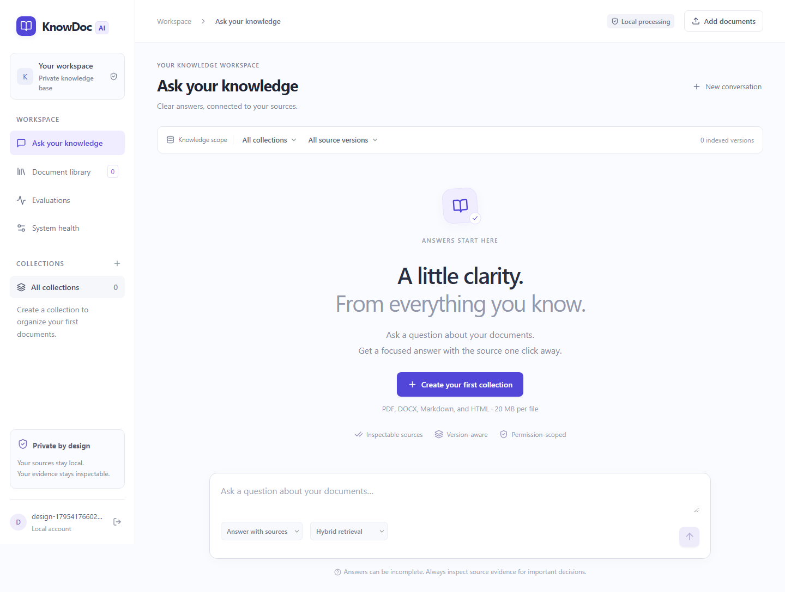

# KnowDoc AI

**Clear answers from your documents, with sources you can inspect.**

**[Open the live cloud demo](https://knowdoc-ai.vercel.app)** | [Cloud features and limits](docs/cloud-deployment.md)

The card-free cloud edition offers keyword search, exact supported profile answers, and citations. General AI generation is disabled. Create a cloud account; existing local accounts and private uploads were not migrated.

A local-first knowledge workspace for PDF, DOCX, Markdown and HTML. PostgreSQL full-text search and pgvector retrieval, optional CPU reranking, local Ollama generation, checksummed source versions, document permissions and resolvable citations.

This is a portfolio implementation with a free-tier demonstration deployment, without a guarantee of correctness or production hardening. Citation integrity is separate from semantic support. Evaluation annotations remain provisional until human review.



## Start locally

Requirements: Python 3.12, uv, Node 24, Docker Desktop and local Ollama. No paid API is required. Close memory-heavy applications on a 16 GB laptop.

```powershell
uv sync --frozen --extra dev --extra ml
.venv/Scripts/python scripts/init_local.py
docker compose up -d db
.venv/Scripts/alembic upgrade head
.venv/Scripts/python scripts/provision_local.py
npm ci --prefix apps/web
npm --prefix apps/web run build
```

In separate terminals:

```powershell
.venv/Scripts/python -m uvicorn knowdoc.api:app --host 127.0.0.1 --port 8000
.venv/Scripts/python -m knowdoc.worker
```

Open **http://127.0.0.1:8000/**. Register locally, create a collection, upload a file, wait for indexing and ask. Answer with sources is the default. Simple explicit profile facts can resolve directly from stored text; other questions use the local model. Evidence only is an optional, explicitly non-generative passage browser. The configured `nomic-embed-text:latest` and `gemma:2b` must already be available in Ollama; inspect their licenses before downloading or redistributing. Pin the embedding digest from local `/api/tags` in `.env` and reindex after model changes.

For frontend development: `npm --prefix apps/web run dev`, then **http://127.0.0.1:5173/**. Vite proxies `/api` to port 8000. Use the configured origin and `127.0.0.1`; localhost database resolution hung on the audited Windows machine.

## Why it differs from a basic document chatbot

- Immutable source versions and parser-derived location metadata; historical citations survive reindexing.
- SQL document permissions before reranking/generation and an authorization recheck after inference.
- Durable leased jobs and atomic replacement indexes that preserve the previous search index on failure.
- Four retrieval baselines and an 80-case provisional benchmark with actual failures.
- Explicit abstention, user-selected evidence-only mode, and both sides of detected source conflicts. Deterministic conflict detection is currently limited to numeric-policy templates.

## Corpus, evaluation and tests

The approved corpus contains 24 official PostgreSQL HTML pages from release documentation archives for 18.7 and 19.0. [Manifest](configs/source-manifest.json), notices and exact hashes preserve provenance. Raw archives/private uploads stay out of Git. Original policy/injection fixtures are clearly fictional.

```powershell
.venv/Scripts/python scripts/fetch_corpus.py
.venv/Scripts/python scripts/import_corpus.py your-local-account@example.com
.venv/Scripts/python scripts/seed_evaluation.py your-local-account@example.com
.venv/Scripts/python scripts/wait_index.py
.venv/Scripts/python scripts/evaluate.py your-local-account@example.com --generation-limit 5
.venv/Scripts/ruff check src tests scripts migrations
.venv/Scripts/pytest -q
npm --prefix apps/web run build
cd apps/web
npx playwright install chromium
npx playwright test
```

Integration tests use a UUID-named PostgreSQL schema, not truncated application tables. Fake embeddings exist only in tests and are never reported as semantic benchmarks. Browser tests use isolated synthetic accounts. Real-corpus measurements use real local inference. [Read methodology and results](docs/evaluation-report.md).

## Documentation

[Status](PROJECT_STATUS.md) · [Setup](docs/developer-setup.md) · [User guide](docs/user-guide.md) · [Architecture](docs/architecture/system-design.md) · [API](docs/api-guide.md) · [Security](docs/security-assessment.md) · [Verification](docs/verification-report.md) · [Runbook](docs/operations/runbook.md) · [Demonstration](docs/project-demonstration.md) · [Interview guide](docs/interview-preparation.md).

Original code: MIT. PostgreSQL excerpts retain their notice. Model weights and dependencies have separate licenses; weights are not redistributed here. The cloud demo uses Neon Free and Vercel; hosted AI is disabled. The local edition supports Ollama.

[Expected behavior and acceptance checks](docs/acceptance-checklist.md).
