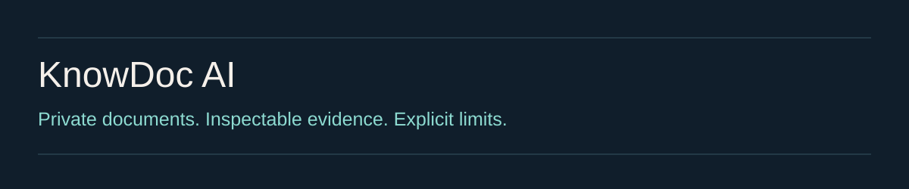
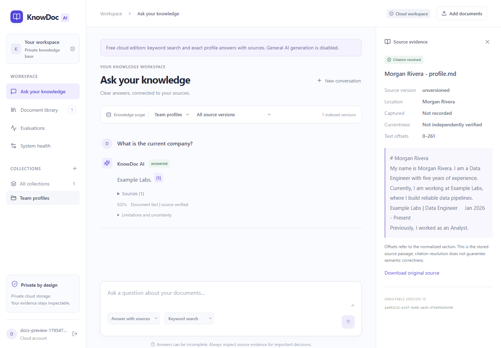

# KnowDoc AI



Document search and question answering with inspectable citations. Upload a source, ask a question, and open the passage behind the answer, including its version and PDF page.

[Live demo](https://knowdoc-ai.vercel.app) | [Getting started](docs/user-guide.md) | [Architecture](docs/architecture/system-design.md) | [Evaluation results](docs/evaluation-report.md)



## What it does

- Ingests PDF, DOCX, Markdown and HTML into private document collections.
- Preserves checksummed source versions and the location of each indexed passage.
- Returns short answers for supported profile facts, with clickable references.
- Supports document sharing, access revocation, version comparison and reindexing.
- Checks document access before retrieval and again before returning answers or resolving citations.

The public demo runs on Vercel and Neon Free. Create an account and upload your own documents; local accounts and uploads are separate from the hosted app.

## Hosted and local editions

| Capability | Public demo | Local installation |
| --- | --- | --- |
| Document storage | Private originals in PostgreSQL | Local files and PostgreSQL metadata |
| Retrieval | PostgreSQL keyword search | Keyword, vector, hybrid and optional reranking |
| Answers | Exact supported profile facts; source passages for other questions | Profile extraction and Ollama generation |
| File limit | 3 MiB per file | 20 MiB per file by default |
| Indexing | Runs during upload or reindex | Durable background worker |
| OCR | Unavailable | Optional Poppler and Tesseract |
| Evaluation | Results can be viewed; benchmark execution disabled | Reproducible local benchmark runs |

General AI generation is disabled in the card-free demo. It does not send documents to an inference provider. The local edition runs Nomic embeddings and Gemma through Ollama. See [cloud limits and operations](docs/cloud-deployment.md).

## Engineering decisions and evaluation boundaries

The hosted edition prioritizes an inspectable, card-free demonstration: keyword retrieval and deterministic supported-profile extraction run without an inference provider. The local edition trades more setup and CPU/model cost for vector retrieval, optional reranking and Ollama generation. These are distinct operating modes, not interchangeable feature claims.

Access checks occur around retrieval and citation resolution, independently of model output filtering. Source versions and exact-span references make answers auditable, but a valid reference alone does not prove a claim is supported.

The [evaluation report](docs/evaluation-report.md) retains failures: plain hybrid underperformed dense retrieval on the developer-authored set, and early generated adversarial outputs included attack text. Focused fixes are regression evidence, not an exhaustive safety rerun. Independent semantic annotation and a full follow-up benchmark remain open.

## Run locally

Requirements: Python 3.12, uv, Node.js 24, Docker and Ollama. The optional reranker also needs the Python `ml` extra.

```powershell
uv sync --frozen --extra dev
ollama pull nomic-embed-text:latest
ollama pull gemma:2b
.venv/Scripts/python scripts/init_local.py
docker compose up -d db
.venv/Scripts/alembic upgrade head
.venv/Scripts/python scripts/provision_local.py
npm ci --prefix apps/web
npm --prefix apps/web run build
```

Run the API and worker in separate terminals:

```powershell
.venv/Scripts/python -m uvicorn knowdoc.api:app --host 127.0.0.1 --port 8000
```

```powershell
.venv/Scripts/python -m knowdoc.worker
```

Open http://127.0.0.1:8000. Pin the embedding model digest in `.env` before indexing sources. Setup details, model configuration and frontend development commands are in the [developer guide](docs/developer-setup.md).

## Stack

React, TypeScript and Vite; FastAPI and SQLAlchemy; PostgreSQL full-text search and pgvector; Ollama for local inference. Alembic manages schema changes. Pytest covers backend behavior and permissions; Playwright covers desktop and mobile workflows.

```text
apps/web/       React interface and browser tests
src/knowdoc/    API, ingestion, retrieval, permissions and answers
migrations/    Database migrations
tests/         Backend tests
scripts/       Setup, evaluation and verification tools
evals/         Evaluation cases and synthetic fixtures
configs/       Source, model and code manifests
docs/          Setup, architecture, operations and measured results
```

## Verification

```powershell
.venv/Scripts/ruff check src tests scripts migrations
.venv/Scripts/python -m pytest -q
npm --prefix apps/web run build
```

With the API and worker running:

```powershell
cd apps/web
npx playwright install chromium
npx playwright test
```

Latest release checks: **37 backend tests passed**, **9 local browser checks passed**, and **2 production browser checks passed**. One desktop-only evaluation screenshot check is intentionally skipped on mobile. A separate live API smoke test covers upload, citation resolution, original download, sharing, revocation, reindexing and deletion.

The local retrieval benchmark uses 24 PostgreSQL documentation pages and 80 developer-authored cases. Results are exploratory: annotations have not had independent review. Citation validation confirms stored references and quotes, not whether every claim is correct. See [evaluation methodology and failures](docs/evaluation-report.md) and [security limits](docs/security-assessment.md).

## Documentation

- [User guide](docs/user-guide.md) and [acceptance checks](docs/acceptance-checklist.md)
- [Developer setup](docs/developer-setup.md) and [API reference](docs/api-guide.md)
- [System design](docs/architecture/system-design.md) and [deployment architecture](docs/architecture/deployment.md)
- [Cloud deployment](docs/cloud-deployment.md) and [operations runbook](docs/operations/runbook.md)
- [Current status](PROJECT_STATUS.md) and [verification record](docs/verification-report.md)

## License

Original code is licensed under [MIT](LICENSE). PostgreSQL excerpts and third-party dependencies retain their own terms; see [third-party notices](THIRD_PARTY_NOTICES.md). Model weights, private uploads, credentials and runtime data are not included in this repository.
