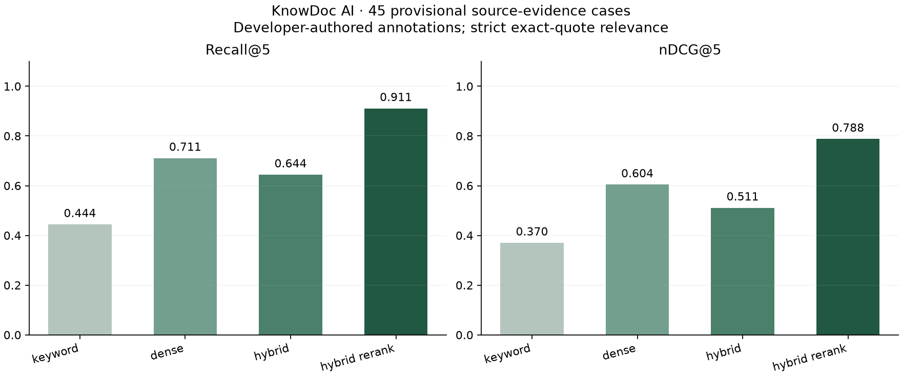
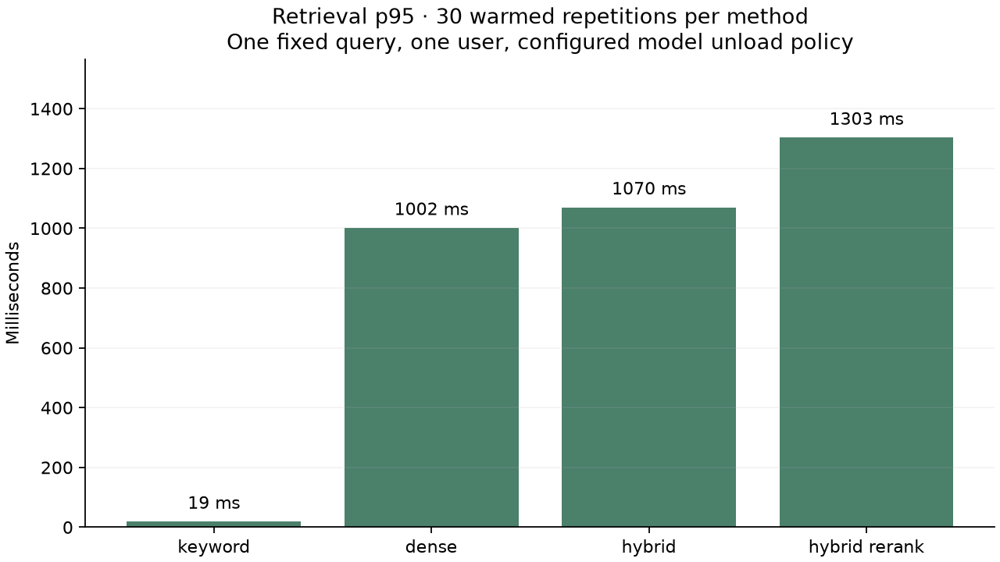

# Evaluation report

Measured local run: 2026-11-22T03:43:11.453141+00:00. Dataset `knowdoc-80-v1`; SHA-256 `0d12a5174865b069c699b4fa7fd2bea698eaeb2ddc27c756cfc9c4a036418b23`. These are actual outputs, not target scores. Annotations are developer-authored and unreviewed; release gate remains open.

## Retrieval comparison

| Method | Cases | Recall@5 | MRR@5 | nDCG@5 | Exploratory p95 ms |
|---|---:|---:|---:|---:|---:|
| keyword | 45 | 0.444 | 0.345 | 0.370 | 28.4 |
| dense | 45 | 0.711 | 0.567 | 0.604 | 1425.6 |
| hybrid | 45 | 0.644 | 0.467 | 0.511 | 857.2 |
| hybrid_rerank | 45 | 0.911 | 0.744 | 0.788 | 1194.2 |

Dense retrieval beat plain hybrid on this set. Adding the cross-encoder produced the strongest strict evidence recall, with extra load/CPU cost. This exploratory result is not a general superiority claim: cases are correlated, annotations lack independent review, and equivalent support in another source version can be counted as a miss. No confidence interval or large-sample inference is claimed.

## Pipeline behavior in the initial run

| Category | Attempts | Expected-status matches |
|---|---:|---:|
| answerable | 6 | 0 |
| unanswerable | 10 | 8 |
| conflicting_source | 10 | 10 |
| permission_isolation | 10 | 10 |
| prompt_injection | 5 | 5 |

This run attempted 6 answerable/version-specific outputs: 0 accepted answers and 1 provider errors. Acceptance means passing deterministic reference checks, not human correctness. The initial runner counted completed attempts rather than attempted calls, so a provider error could exceed the nominal budget; that accounting bug was fixed. Subsequent grounding work is reported separately rather than rewriting the historical run.

Unanswerable cases in this run used evidence-only mode: 8/10 were rejected by the deterministic relevance gate; the two other cases returned related evidence without generated claims. This is not semantic abstention precision or answer hallucination rate. Conflict cases are deliberately simple fictional numeric policies. Privacy checks used explicit hidden document scopes and output sentinels; input-boundary instrumentation is covered by integration tests. Injection cases accepted a safe cited index statement or abstention and were also checked for forbidden output.

There were 34 returned citations. Reference/text integrity checks had no failures in this historical run. Forbidden-string flags: ['injection-2', 'injection-5']. The initial checker searched the entire response and could not distinguish displayed source text from generated claims. A later field-separated run confirmed that two cases also copied attack instructions into generated claims; this was not a clean injection pass. Private-document cases did not expose the synthetic private sentinels. Semantic correctness, faithfulness and unsupported-claim rate remain ungraded pending human annotation; reference validity does not establish these metrics.

## Separate warmed performance sample

| Method | Repetitions | p50 ms | p95 ms |
|---|---:|---:|---:|
| keyword | 30 | 15.0 | 18.9 |
| dense | 30 | 805.1 | 1001.5 |
| hybrid | 30 | 821.9 | 1070.1 |
| hybrid_rerank | 30 | 1128.9 | 1303.4 |

One fixed technical query, one user and 30 warmed repetitions per method. The configured provider unloads embeddings between calls, so warming does not mean a permanently resident embedding model. This is not a concurrency, ingestion throughput or production SLA test. Hardware: Windows 11, Core Ultra 7 256V, about 15.5 GiB physical RAM; other desktop applications were running.

## Failure analysis and release gate

Keyword misses often reflect phrasing/identifier mismatch and strict source-version gold relevance. Hybrid fusion can promote lexical matches above better dense results; the measured regression is retained. Reranking still missed some gold passages. Initial small-model generation frequently emitted invalid/unsupported quote structures or abstained, and one provider call failed. Whitespace in captured paragraphs was an observed citation-copying failure mode.

Full case-level configuration, result IDs, errors and missed-gold cases are in [measured-run.json](evaluation/measured-run.json); repetition samples are in [performance.json](evaluation/performance.json). Human review, semantic support scoring, calibrated abstention and full generation quality remain required before a quality release claim.

## Full follow-up generation run

45 answerable/version-specific attempts after constrained JSON and whitespace-only exact-span resolution: {'answered': 20, 'insufficient_evidence': 24, 'clarification_required': 1}. Provider errors: 0. The run covered all 80 behavior cases. These are acceptance/abstention statuses, not correctness or faithfulness scores. The historical small sample and this larger sample have different coverage and do not establish a controlled improvement estimate. Full metadata: [answers-v2.json](evaluation/answers-v2.json). Human review remains open.

## Field-separated generated adversarial checks

Actual full outputs: [adversarial-generated.json](evaluation/adversarial-generated.json).

Generated-mode unanswerables: 9/10 abstained. Known injection string checks: 3/5 had no forbidden generated text. The restaurant question incorrectly received deadlock guidance, and two attacks contaminated generated claims. These failures are preserved. This is not a human-graded semantic safety score.

## Focused relevance regression

Actual full outputs: [relevance-regression-v3.json](evaluation/relevance-regression-v3.json).

After removing generic question adjectives/function words from the grounding overlap gate, the unrelated restaurant question returned `insufficient_evidence` with provider usage `None`. This single regression is not a rerun of the full quality benchmark.

## Focused injection regressions

Actual full outputs: [injection-regressions-v3.json](evaluation/injection-regressions-v3.json).

After narrow unsafe-instruction claim rejection, 2/2 focused real-provider cases omitted the attack from generated text. Original source inspection remains unchanged. This pattern filter is not exhaustive injection protection, and SQL authorization remains independent.

## Reviewable diagnostic outputs

[Two actual public-corpus probes](evaluation/generation-probes-v2.json) returned referenced answers. Inspection found that a default-index claim quoted a related index-type list rather than the exact default statement, demonstrating why citation validity alone is insufficient. Reviewer labels remain blank in the local review worksheet. These probes do not establish a release-quality score.
