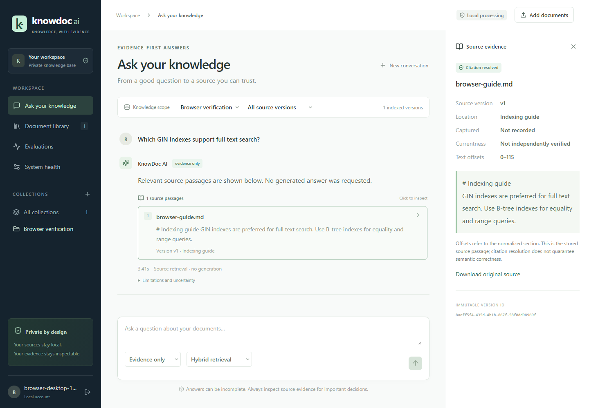
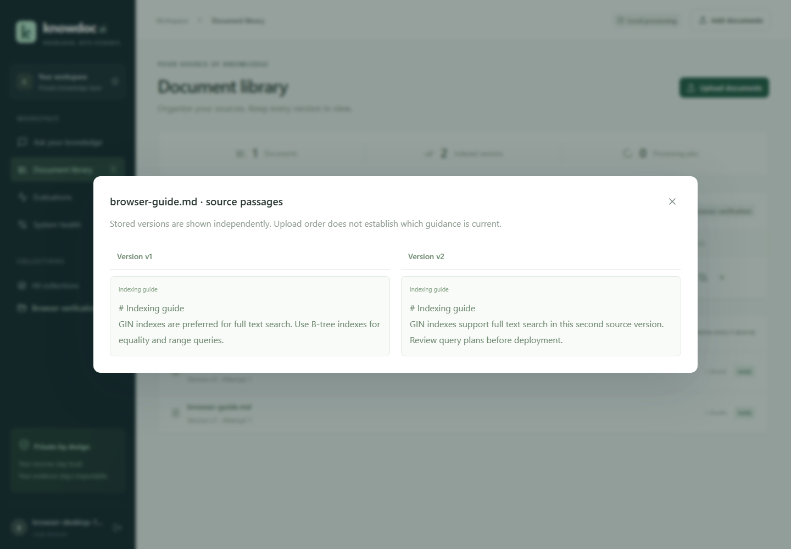
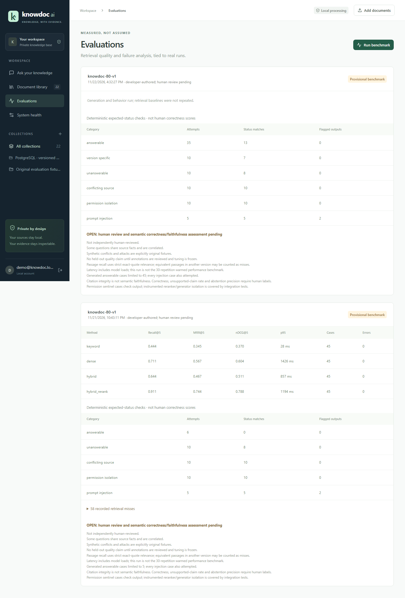

# Feature walkthrough

The hosted app is available at https://knowdoc-ai.vercel.app. Create an account, add a collection and upload a short synthetic profile. Ask for its name or current company, then open the reference and inspect the stored passage. Try a general question to see the source-search fallback and explicit no-generation notice. Sharing and revocation can be checked with a second test account. See [cloud limits](cloud-deployment.md).

The walkthrough below covers the full local edition, including generation and evaluation features that are disabled in the hosted app.

Use synthetic local accounts/public documents. Never display private uploads, credentials or unrelated user tabs.

## Five-minute demonstration

1. Show a real ready ingestion job and two declared source versions.
2. Retrieve full-text-index guidance in Evidence only mode and open the exact passage/version.
3. Select Answer with sources; inspect valid output or an abstention. References identify evidence but do not independently prove correctness.
4. Compare source versions. Equal guidance is legitimate; do not invent changes.
5. Demonstrate opposing original 30/90-day retention fixtures, clearly labelled fictional.
6. Open an actual evaluation run and explain metrics, failures and the pending human-review gate.

## Two-minute introduction

KnowDoc AI helps engineers navigate evolving documents with inspectable evidence. Logical documents preserve checksummed versions, retrieved chunks carry source locations, and citations resolve from stored records. PostgreSQL full-text/vector retrieval, optional CPU reranking and local generation support a no-paid-API demo. Permissions filter passages before model input and recheck when answers return. A provisional 80-case benchmark covers source evidence, abstention, original conflicts, privacy and injection. The key limitation is that citation validity is separate from semantic support, so quality claims require measured results and reviewed annotations.

## Five-minute architecture / ten-minute deep dive

Explain PostgreSQL durability, leased jobs and atomic index activation, source/version/chunk identities, authorized retrieval joins, RRF, local aliases and citation validation. For the deep dive, walk through one failed-reindex test and one mid-generation revocation test, then discuss benchmark strict relevance and unreviewed annotations. Use measured report values rather than invented improvements.

## Portfolio description and resume wording

A local-first, version-aware document intelligence platform with private collections, asynchronous ingestion, hybrid retrieval and source-resolved evidence. Describe it as a tested portfolio implementation, not a production enterprise deployment.

- Implemented multi-format checksummed ingestion, PostgreSQL job leases and historical citations; verified version filtering and failure-preserving reindexing in integration tests.
- Enforced ownership/document grants before local model input, with automated two-user isolation and mid-generation revocation tests.
- Authored an 80-case provisional benchmark and reproducible retrieval comparisons; use actual measured values from the report for quantified claims.

## Verified application screenshots

These captures show synthetic local test documents/accounts and actual persisted benchmark results. They are not mockups.

[Mobile citation view](screenshots/mobile-citation.png).

